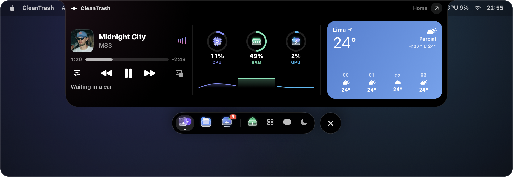
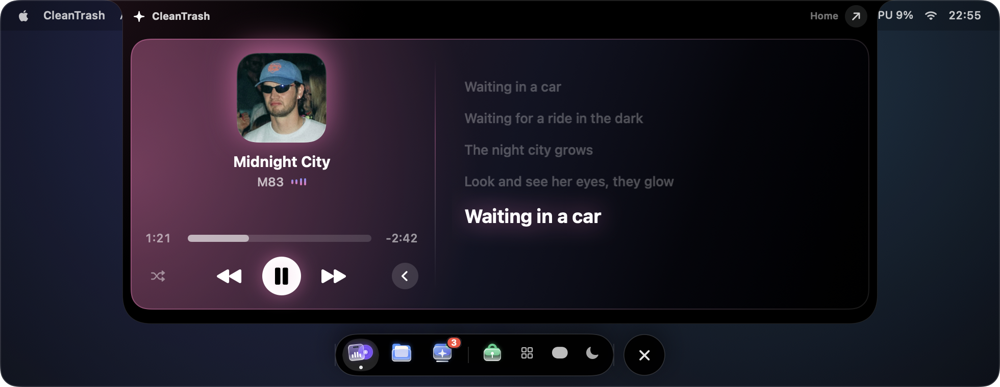
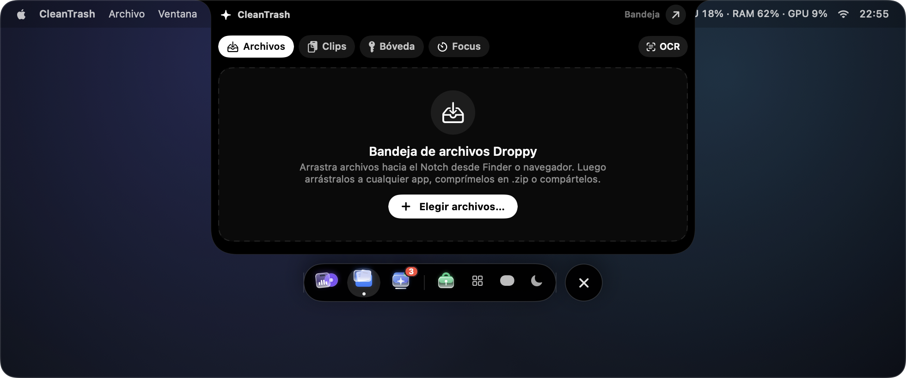
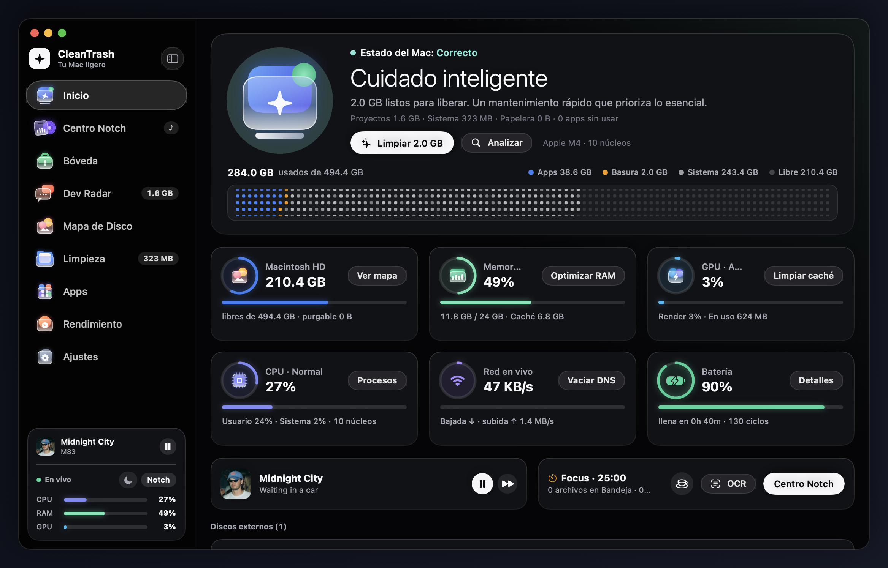
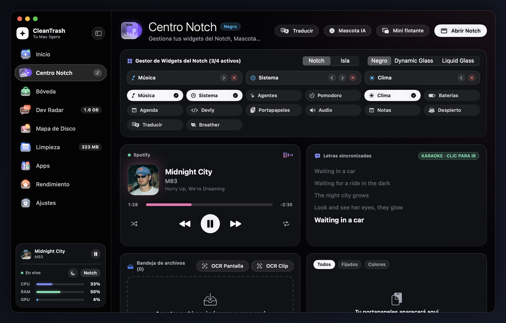
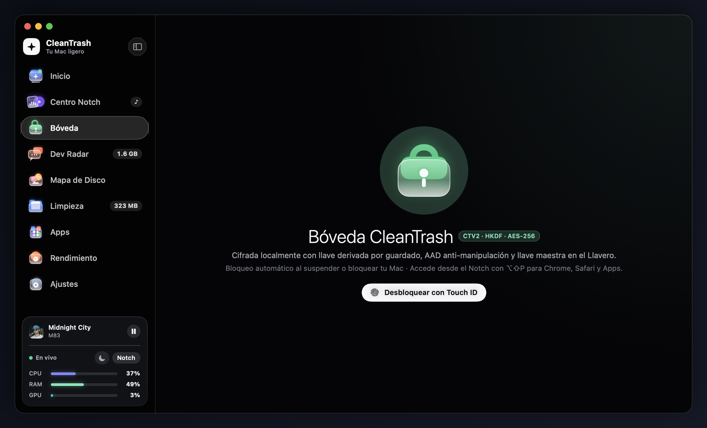

<p align="center">
  
</p>

<h1 align="center">CleanTrash</h1>

<p align="center">
  Native macOS cleaner, Dynamic Notch productivity hub, AI coding-agent monitor, and local Touch ID Password Vault for Apple Silicon.
</p>

<p align="center">
  <sub>Swift 6 · SwiftUI · AppKit · macOS 15+ / Liquid Glass · 100% Local</sub>
</p>

<p align="center">
  
</p>

---

## Dynamic Notch

Lives over the MacBook hardware notch — or floats as a Dynamic Island — in **Negro**, **Dynamic Glass**, or **Liquid Glass**, with a subtle floating capsule dock.

- **Now Playing & Karaoke**: Spotify & Apple Music controls, marquee title/artist & waveform ears, clickable track/artist links, side-by-side synced lyrics theater, and a draggable adaptive floating mini-player tinted from album artwork.
- **Drop Shelf & Vision OCR**: Drag files in/out of the Notch to zip, AirDrop, convert `PNG ↔ JPG`, or extract text locally with Apple Vision OCR.
- **Clipboard & Focus**: Rich clipboard history (text, hex colors, images, pins) and built-in Pomodoro timer.
- **Quick Vault AutoFill (`⌥⇧P`)**: Touch ID–protected search inside the Notch that detects the active site in Chrome, Safari, Arc, Brave, or Edge and auto-fills credentials with one click.
- **AI Coding Agents**: Live status verbs (`Pensando…`, `Editando…`, `Ejecutando…`) in the closed ear, inline Allow / Deny permission cards for Claude Code, Codex, and Antigravity, plus an optional desktop mascot (`⌥⇧M`).
- **Modular Home Widgets**: Drag-and-reorder up to 4 live widgets — Music, System Vitals, Agents, Breather (20-20-20 eye rest/stretch/water), On-Mac Quick Translate (`⌥⇧T`), Weather, Bluetooth Batteries, Calendar, Devly tools, Quick Notes, Audio, and Stay Awake.

<p align="center">
  
  
</p>

---

## Main App

A unified Dynamic Glass desktop workspace with layered frosted-glass icons and live Menu Bar telemetry (`CPU · RAM · GPU`).

<p align="center">
  
</p>

- **Smart Overview**: One-click health check, live APFS storage bar, and instant cleanup summary.
- **Notch Studio**: Manage active Notch widgets, surface style, floating mini-player, translator, mascot, clipboard, and shelf from one screen.
- **Encrypted Password Vault (`CTV2`)**: Local `AES-GCM-256` + `HKDF-SHA256` + AAD vault locked by Touch ID, auto-locking on sleep/idle with zero-trace clipboard. Import NordPass/Chrome CSVs, deduplicate & audit weak/reused passwords, export encrypted `.ctvault` backups, or export to Apple Passwords for iPhone Face ID sync.
- **Dev Radar**: Watches workspaces via FSEvents for `target/`, `node_modules/`, `.build/`, `DerivedData`, `.venv`, and caches — with an active-build guard so running compiles are never touched.
- **APFS Disk Map**: Parallel real-block disk mapper with interactive treemap and cleanable hints.
- **System Junk & Apps Audit**: Safe cache/log/simulator/installer cleanup plus unused-app triage with deep uninstall across `~/Library`.
- **Performance**: Live CPU, Unified Memory, and Apple Silicon GPU metrics with safe RAM optimization, Metal cache trimming, APFS snapshot thinning, and DNS flush.

<p align="center">
  
  
</p>

---

## Shortcuts

| Shortcut | Action |
| :--- | :--- |
| `⌥⇧P` | Open Password Vault AutoFill in Notch |
| `⌥⇧T` | On-Mac Quick Translate panel |
| `⌥⇧M` | Toggle AI Agent desktop mascot |
| `⌘N` | Toggle Dynamic Notch |

## Build & Run

```bash
# Run unit tests
swift test

# Build, sign, install to /Applications/CleanTrash.app, and launch
./scripts/build-app.sh release --install --run
```
