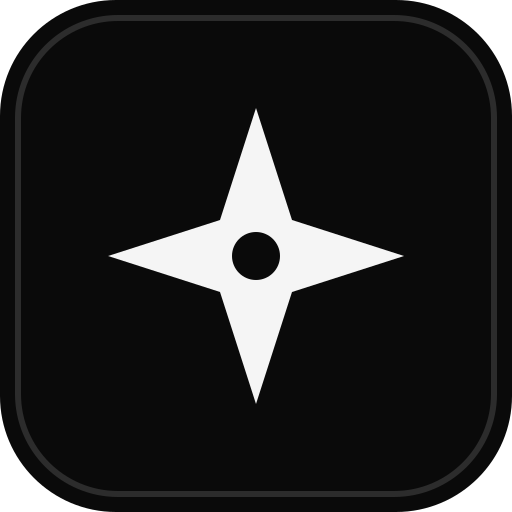

# CleanTrash

Native **Swift 6 + SwiftUI + AppKit (macOS 27)** Mac cleaner, developer build-artifact radar, APFS disk space mapper, unused-app auditor, and live hardware Dynamic Notch HUD — engineered exclusively for Apple Silicon Macs in a monochrome black-and-white design language inspired by **monoBOT**.

## Features

- **Dynamic Monochrome Notch & Menu Bar HUD**: Sits over the MacBook hardware camera housing (or floats as a pill), showing live RAM/GPU ears, spring-animated hover/click expansion, and instant live notices when Cargo `target/`, `node_modules/`, or memory pressure spikes.
- **Dev Radar (Auto-Detecting via FSEvents)**: Automatically watches developer workspaces (`~/Developer`, `~/.t3/projects`, etc.) for Rust `target/`, Node/Bun `node_modules/`, `.next`, `.turbo`, `dist`, Swift `.build/`, Xcode `DerivedData`, Python `.venv`, Gradle/Go caches, and AI model/agent caches — with an **Active-Build Guard** so live compilations are never deleted.
- **Live Telemetry & Performance**: Real-time CPU, Unified Memory breakdown (`host_statistics64` + kernel pressure + swap), **Apple Silicon GPU** (`IOAccelerator` `Device %`, `Renderer %`, `Tiler %`, active/allocated GPU memory), Disk, Battery, Network throughput, safe RAM optimization, GPU Metal/WebGPU cache trimming, APFS local snapshot thinning (`tmutil`), and DNS cache flush.
- **APFS Disk Space Map**: Parallel disk mapper using real allocated APFS blocks (`totalFileAllocatedSizeKey`), skipping evicted iCloud placeholders, respecting volume boundaries, and rendering an interactive monochrome Treemap + Swift Charts category donut with cleanable hints.
- **System Junk Cleaner**: User/Darwin/Container/Electron caches, logs, Xcode/Simulator caches, broken `.plist` preferences, dangling `LaunchAgents`, Trash, and old `.dmg/.pkg` installers.
- **Unused Apps & Deep Uninstaller**: Uses Spotlight `kMDItemLastUsedDate` to surface untouched apps with a `"Still using this?"` triage queue (Keep / Ask in 30d / Deep Uninstall) and maps all 10 associated `~/Library` locations plus orphaned leftovers.

- **Background Automation & Launch at Login**: `SMAppService` launch at login, automatic critical-RAM optimization, optional auto-cleanup of stale dev targets when free space drops below your minimum, external drive monitoring & safe eject, and automatic Notch prompts for untouched apps.

## Build, Install & Run

```bash
# Run unit tests
swift test

# Build, install to /Applications/CleanTrash.app, and launch
./scripts/build-app.sh release --install --run
```
